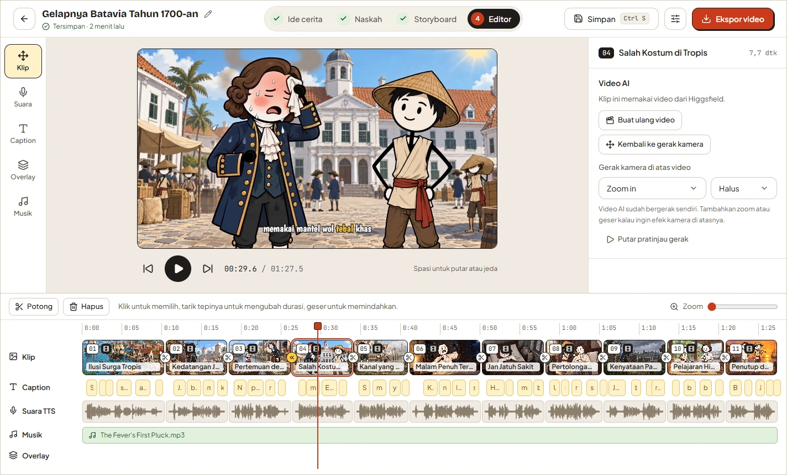
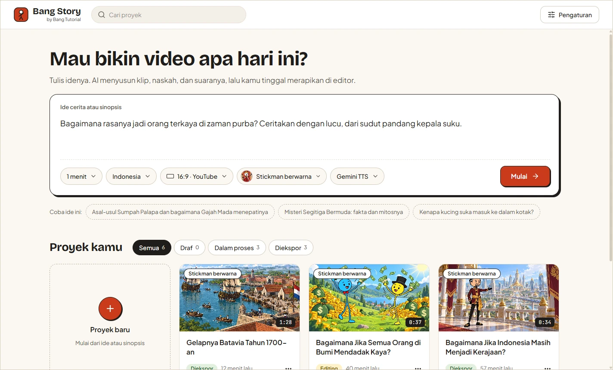
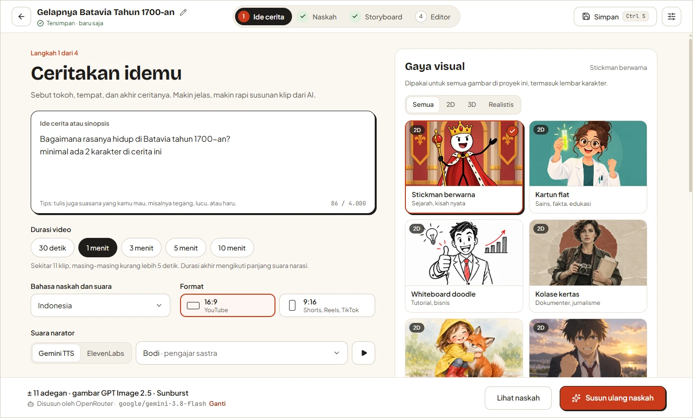
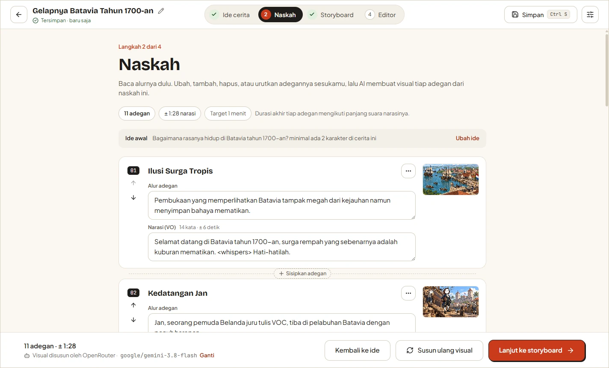
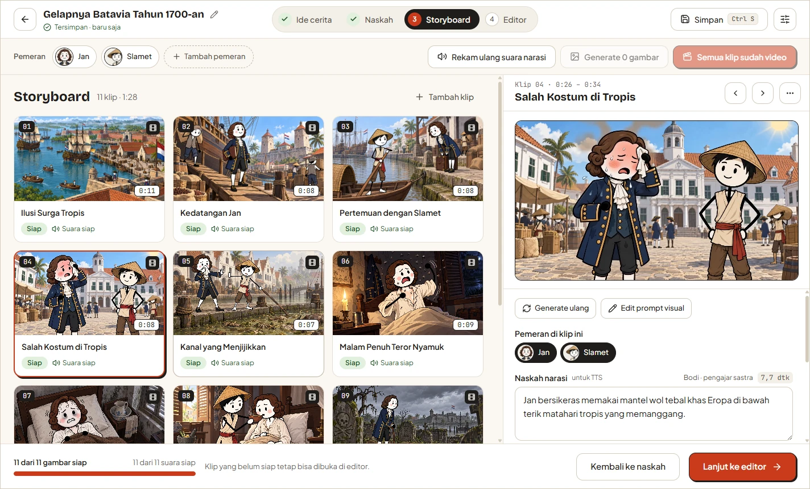
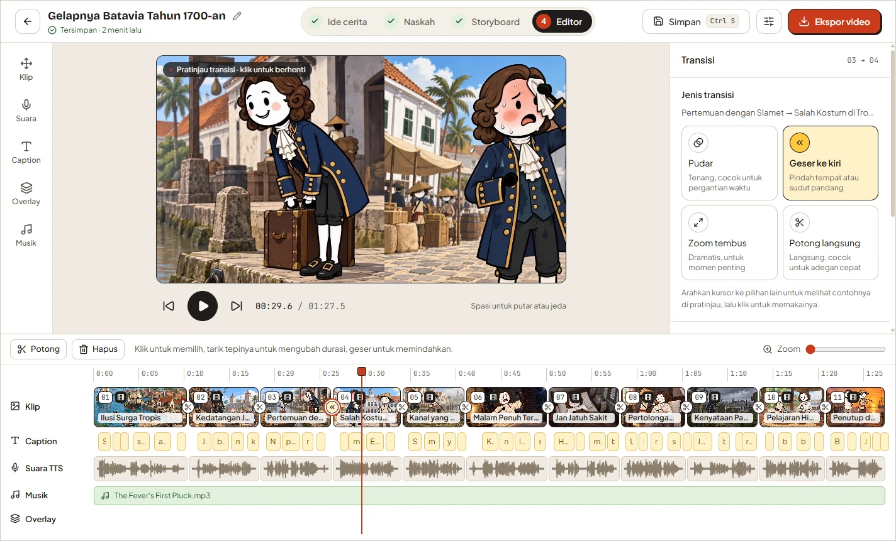
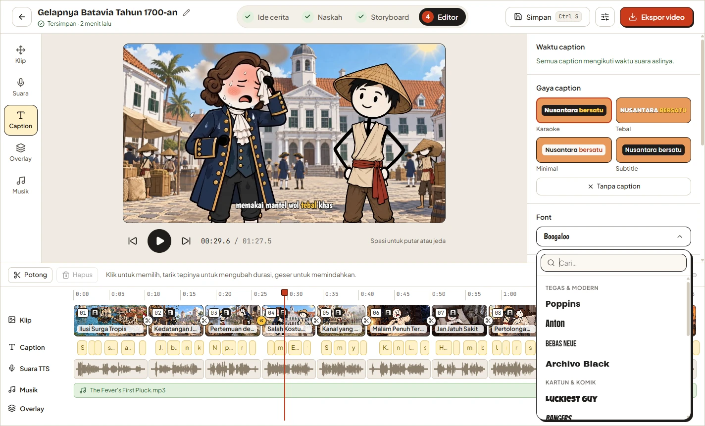

<div align="center">


# AUDIRA STORY
### Studio Produksi Video Cerita YouTube Berbasis AI & Timeline Non-Linear Desktop

**Ciptakan Video Cerita YouTube & Media Sosial Siap Siar Langsung dari Ide Mentah.**

[](CHANGELOG.md)
[](LICENSE)
[-blue.svg?style=for-the-badge)](https://github.com/audira)
[](#kebutuhan-sistem)
[](#arsitektur--teknologi)

[Ikhtisar](#-ikhtisar-produk) • [Fitur Unggulan](#-fitur-unggulan) • [Tampilan Antarmuka](#-tampilan-antarmuka) • [Mulai Cepat](#-panduan-memulai-cepat) • [Kunci API & Privasi](#-kunci-api-byok--privasi) • [Lisensi Komersial](#-lisensi-komersial--proprietary) • [Kontak](#-kontak--pembelian-lisensi)

---



</div>

---

## 🌟 Ikhtisar Produk

**Audira Story** adalah aplikasi desktop komersial *all-in-one* yang mentransformasikan ide cerita tertulis menjadi video YouTube, Shorts, Reels, dan TikTok profesional secara otomatis dan terpadu. 

Diciptakan dan dikembangkan secara eksklusif oleh **Agus Dwi R (AUDIRA)**, Audira Story mengintegrasikan ekosistem kecerdasan buatan multi-tier terbaik ke dalam alur kerja produksi video berstandar broadcast:
- ✍️ **Penulisan Naskah AI:** Mengubah sinopsis singkat menjadi naskah adegan sinematik lengkap dengan narasi vokal.
- 🎨 **Konsistensi Visual Karakter:** Membuat lembar karakter (*character sheet*) tampak multi-arah via Higgsfield AI sebagai referensi gambar adegan.
- 🎬 **Generasi Video AI:** Menganimasikan gambar adegan menjadi klip video AI beresolusi tinggi tanpa musik bawaan yang mengganggu.
- 🎙️ **Narasi Suara Alami (Single-Take):** Rekaman narasi satu take utuh via Google Gemini TTS atau ElevenLabs untuk menjamin kestabilan timbre suara.
- ⏱️ **Sinkronisasi Caption Sub-Detik:** Mesin pengenal suara lokal **whisper.cpp** dengan Dynamic Time Warping (DTW) untuk penandaan waktu kata presisi tanpa halusinasi prompt.
- 🎞️ **Editor Timeline Non-Linear:** Timeline magnetis dengan audio tertaut, pemotongan pada jeda kata (*word-boundary split*), efek kamera dinamis, dan 15 font subtitle caption berkotak rounded.
- 🚀 **Mesin Ekspor Broadcast FFmpeg:** Render video MP4 1080p/720p/4K dengan filter kamera `perspective` bebas getar (*sub-pixel smoothness*), transisi `xfade` aman, dan penyeimbang audio −14 LUFS standar YouTube.

---

## ⚡ Fitur Unggulan

### 1. 💡 Eksplorasi Ide & Perencanaan Otomatis
- Tulis satu premis cerita (contoh: *"Misteri penjelajah waktu yang terjebak di Batavia kuno"*).
- Tentukan durasi target (30 detik hingga 10+ menit), format rasio video (16:9 Landscape atau 9:16 Portrait), dan bahasa naskah.
- Kalkulasi adegan otomatis (~5,5 detik per adegan atau ~2,6 kata per detik).
- Estimasi biaya kredit Higgsfield transparan sebelum memulai produksi.

### 2. 📝 Editor Naskah Beradegan & Voice Tags
- Pengaturan alur cerita per adegan: edit narasi, tambah, hapus, dan atur ulang urutan klip.
- Dukungan Voice Tags ekspresif untuk mengontrol intonasi narator AI: `<short pause>`, `<long pause>`, `<chuckles>`, `<sigh>`, `<gasp>`, `<whispers>`.
- Pembuatan rencana visual mandiri per adegan (`Setting`, `Action`, `Wardrobe`, `Framing`, `Avoid`).

### 3. 🎭 Konsistensi Tokoh & Produksi Visual Higgsfield
- **Lembar Karakter Otomatis:** Membuat referensi tokoh tampak depan, samping, dan 3/4 dengan latar studio polos.
- **Katalog 48 Model AI:** 14 model text-to-image dan 34 model image-to-video (GPT Image 2.5, Kling 3.0, dll).
- Resolusi frame dan durasi video disesuaikan otomatis dengan panjang suara narasi klip (`fitDuration`).

### 4. 🗣️ Narasi Tunggal & Sinkronisasi Caption Whisper Offline
- **Single-Take Studio Recording:** Merekam seluruh naskah dalam satu kali take untuk menjamin konsistensi vokal narator.
- **Whisper Lokal Terintegrasi:** Menjalankan `whisper-cli.exe` secara lokal tanpa mengirim audio ke server luar.
- **Algoritma DTW Tanpa Prompt:** Mencegah halusinasi loop pengulangan kata pada teks. Ejaan kata diambil dari naskah asli, sedangkan timestamp kata diambil dari audio.
- Pemotongan adegan otomatis pada jeda hening alami di antara kata, tanpa memotong suku kata.

### 5. ✂️ Editor Timeline Magnetis (Non-Linear Editing)
- **Track Klip Magnetis:** Klip tersusun otomatis tanpa celah (*gapless*), snapping 8px pada sambungan dan playhead.
- **Audio Klip Tertaut:** Suara narasi terikat pada adegannya; potong awal (`voiceInMs`), potong akhir (`voiceOutMs`), dan geser posisi (`voiceStartMs`).
- **Pemisahan Klip Instan (`S` / `Ctrl+B`):** Membelah klip tepat di playhead dengan membagi narasi dan menduplikasi media visual.
- **Pratinjau Multi-Klip Terisolasi:** Engine 3-klip tanpa jeda/kedip hitam (*no frame flicker*).
- **Gerak Kamera Dinamis:** Pan, Zoom, Tilt, dan Static dengan mode *Audition* instan.
- **Tipografi Subtitle Caption:** 15 font kurasi (Bangers, Poppins, Lilita One, Anton, dll) dengan sorotan kata aktif dan kotak rounded halus.
- **Trek Musik & Overlay:** Musik latar dengan penyesuaian volume desibel (dB) dan auto-ducking saat narasi berbunyi.

### 6. 🎬 Mesin Ekspor Broadcast FFmpeg MP4
- Render video MP4 (H.264 / AAC) langsung di komputer lokal pengguna.
- **Filter `perspective` Sub-Pixel:** Menghilangkan getaran piksel (*micro-jitter*) yang biasa muncul pada filter `zoompan`.
- **Buffer Frame Pengaman `xfade`:** Menjamin stabilitas video pada transisi antar klip.
- Subtitle ASS termuxing sempurna melalui `libass` dengan metrik font TTF asli.

---

## 🖥️ Tampilan Antarmuka

Antarmuka Audira Story dibangun di atas filosofi desain editorial **"Paper & Ink (Kertas & Tinta)"** yang nyaman di mata, terstruktur rapi, dan taktil:

<table>
  <tr>
    <td width="50%" valign="top">
      <br>
      <b>Beranda:</b> Manajemen proyek dan pembuatan cerita baru.
    </td>
    <td width="50%" valign="top">
      <br>
      <b>Ide Cerita:</b> Pemilihan durasi, rasio video, suara narator, dan model AI.
    </td>
  </tr>
  <tr>
    <td width="50%" valign="top">
      <br>
      <b>Naskah:</b> Editor adegan, penataan narasi, dan perencanaan visual.
    </td>
    <td width="50%" valign="top">
      <br>
      <b>Storyboard:</b> Produksi gambar klip, lembar karakter, dan audio narasi.
    </td>
  </tr>
  <tr>
    <td width="50%" valign="top">
      <br>
      <b>Transisi:</b> Pilihan transisi dissolve, wipe, slide dengan live loop preview.
    </td>
    <td width="50%" valign="top">
      <br>
      <b>Caption Subtitle:</b> 15 font pilihan dengan live sample dan rounded box.
    </td>
  </tr>
</table>

---

## 🏗️ Arsitektur & Teknologi

Audira Story dibangun dengan arsitektur hybrid performa tinggi:

| Komponen | Teknologi | Keterangan |
| :--- | :--- | :--- |
| **Aplikasi Desktop** | **Electron 44** | Chromium + Node.js dengan pengerasan keamanan sandboxing ketat |
| **Build Tooling** | **electron-vite 5, Vite 7** | Kompilasi kilat untuk proses main, preload, dan renderer |
| **Frontend UI** | **React 19 + Tailwind CSS v4** | Antarmuka reaktif modern, design token taktil di `@theme` |
| **Manajemen State** | **Zustand** | Manajemen store atomik untuk snapshot proyek dan editor |
| **Database Lokal** | **SQLite (better-sqlite3)** | Penyimpanan data proyek dan riwayat cepat dengan `PRAGMA user_version` |
| **Video Engine** | **FFmpeg Static + libass** | Rendering video MP4 broadcast dengan filter graph canggih |
| **Speech Recognition** | **whisper.cpp (C++ Native)** | Transkripsi offline lokal dengan akselerasi CPU AVX/AVX2/SSE4.2 |
| **Layanan AI** | **Higgsfield, Gemini, ElevenLabs** | Integrasi AI multi-provider dengan sistem Bring Your Own Key (BYOK) |

---

## 🚀 Panduan Memulai Cepat

### Kebutuhan Sistem:
- **Sistem Operasi:** Windows 10/11 64-bit (Direkomendasikan) atau macOS.
- **Memori RAM:** Minimal 8 GB (Disarankan 16 GB+ untuk ekspor video resolusi tinggi).
- **Prosesor:** CPU multi-core modern (Intel Core i5/i7/i9 atau AMD Ryzen) dengan dukungan AVX.
- **Penyimpanan:** Minimal 2 GB ruang disk kosong untuk model Whisper dan cache proyek.

### A. Menggunakan Installer Windows (Cara Termudah)
1. Unduh installer resmi **`AudiraStory-Setup-1.0.0.exe`**.
2. Jalankan installer dan ikuti petunjuk di layar hingga selesai.
3. Buka aplikasi Audira Story dari Shortcut Desktop.
4. Masukkan kunci API kamu di **Pengaturan › Layanan AI dan Kunci**, lalu mulai berkarya!

### B. Menggunakan Skrip Portabel START
- **Windows:** Klik 2x file `START - WIN.bat`.
- **macOS:** Klik 2x file `START - MAC.command` (Jalankan `chmod +x "START - MAC.command"` jika memerlukan izin eksekusi).

### C. Menjalankan dari Kode Sumber (Pengembang)
```bash
# 1. Pasang dependensi dan kompilasi ulang modul biner native
npm install

# 2. Jalankan dalam mode pengembangan (hot reload renderer aktif)
npm run dev

# 3. Pemeriksaan tipe TypeScript ketat
npm run typecheck

# 4. Bangun berkas distribusi produksi
npm run build

# 5. Bangun paket installer Windows NSIS
npm run dist
```

---

## 🔑 Kunci API (BYOK) & Privasi

Audira Story mengusung prinsip **Kedaulatan Data & Bring Your Own Key (BYOK)**:
- **Tanpa Server Perantara:** Panggilan API dilakukan langsung dari komputer lokal kamu ke penyedia layanan AI. Tidak ada pihak ketiga yang mengumpulkan naskah atau video kamu.
- **Enkripsi Kriptografis OS (DPAPI):** Kunci API pengguna dienkripsi menggunakan Electron `safeStorage` (Windows DPAPI) yang terikat langsung dengan akun login Windows kamu di tabel database `secrets`.
- **Kemandirian Penuh:** Proyek, file gambar, video render, dan database disimpan 100% di komputer lokal (`%APPDATA%\Audira Story`).

| Penyedia Layanan | Fungsi Utama | Kebutuhan |
| :--- | :--- | :--- |
| **[Higgsfield AI](https://higgsfield.ai)** | Gambar klip, lembar karakter, video AI | Wajib untuk pembuatan visual AI |
| **Google Gemini** | Pembuatan naskah/visual & suara narator Gemini TTS | Wajib salah satu (atau LLM lain) |
| **ElevenLabs** | Suara narasi vokal presisi dengan timestamp kata | Opsional (Alternatif TTS) |
| **OpenRouter / Groq / Ollama** | Model LLM alternatif (Llama 3, DeepSeek, Qwen) | Opsional (Kompatibel OpenAI) |

---

## 📜 Lisensi Komersial / Proprietary

> [!IMPORTANT]
> **AUDIRA STORY ADALAH PERANGKAT LUNAK PROPRIETARY / KOMERSIAL BERBAYAR.**  
> Seluruh kode sumber, arsitektur, aset desain, dan binernya adalah karya cipta eksklusif milik **AGUS DWI R (AUDIRA)**.

### Ketentuan Lisensi:
1. **Hak Cipta Dilindungi Undang-Undang:** Hak cipta perangkat lunak ini secara mutlak dipegang oleh Agus Dwi R (AUDIRA).
2. **Penggunaan Berlisensi:** Penggunaan perangkat lunak ini memerlukan lisensi resmi yang valid.
3. **Hasil Karya Pengguna Bebas Royalti:** Seluruh konten video (MP4) yang kamu produksi, render, dan ekspor menggunakan Audira Story adalah milik kamu sepenuhnya dan dapat dimonetisasi bebas di YouTube, media sosial, atau televisi tanpa royalti kepada pembuat aplikasi.
4. **Larangan Pembajakan & Plagiarisme:** Dilarang keras mendistribusikan ulang, menjual kembali (*reselling*), menyewakan, membongkar biner (*reverse engineering*), merebrand, atau mempublikasikan kode sumber ini ke pihak ketiga tanpa izin tertulis resmi dari Pemegang Hak Cipta.

Detail ketentuan hukum lengkap tercantum pada berkas [**`LICENSE`**](LICENSE).

---

## 🤝 Kontak & Pembelian Lisensi

Untuk informasi pembelian lisensi komersial, kemitraan studio konten, lisensi enterprise, atau konsultasi kustomisasi:

- **Pencipta & Pemilik Lisensi:** **Agus Dwi R (AUDIRA)**
- **GitHub:** [https://github.com/audira](https://github.com/audira)
- **Produk:** Audira Story (`AUDIRA-STICK-STORY`)
- **Status Lisensi:** Commercial / Proprietary (Berbayar)

---

<div align="center">

**Hak Cipta © 2026 Agus Dwi R (AUDIRA). Seluruh hak cipta dilindungi undang-undang.**  
*Dibuat dengan dedikasi untuk kreator cerita dan animator masa depan.*

</div>
